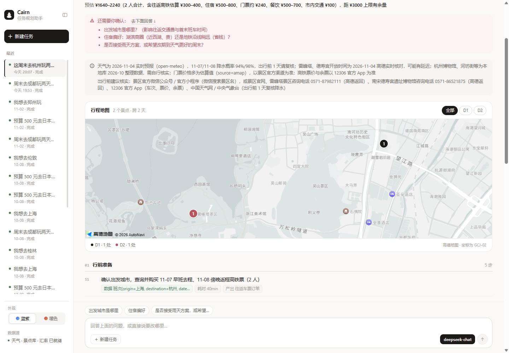
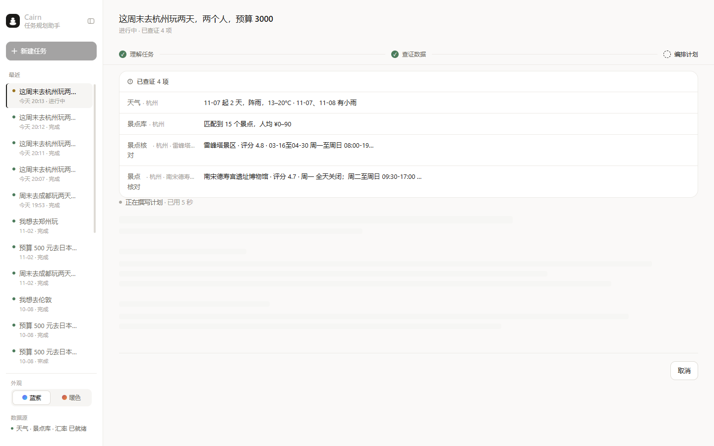
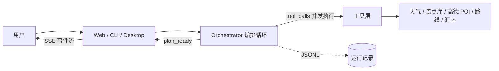

# Cairn · 任务规划助手

> 把一句「我想周末去成都玩两天」，变成一份**有序、可执行、带依赖关系**的行动计划。
>
> 一个基于 **MCP 协议**的工具调用 Agent —— 自己查天气、翻景点库、算交通、核对开放时间，查不到就如实说，绝不编。

**Cairn** <u>/kern/</u> —— 徒步时用石头堆起的路标。名字取自它和这个项目的三处同构：**一块一块垒起来**（每个事实都经工具查证后才写进计划）、**只用手里真有的石头**（查不到就说查不到）、立在**不熟悉的地形**里（任务越模糊，越要先澄清再规划）。


---

## 截图



<p align="center"><sub>查证完成后产出的计划：澄清提示、数据时效、行程地图、分阶段步骤</sub></p>

<table>
<tr>
<td width="50%"><br><sub><b>首页</b> —— 一句话描述需求，也可以点示例</sub></td>
<td width="50%"><br><sub><b>查证与生成</b> —— 实时显示查到了什么、正在写什么</sub></td>
</tr>
</table>

---

## 它做什么

```
阶段(phase) → 步骤(step) → 动作(action) → 工具(tool) → 前置依赖(depends_on)
           → 预估耗时(eta) → 产出物(deliverable) → 验收标准(done_when)
```

同时输出 **Markdown 人类可读版** 和 **JSON 机器可解析版**，后者带依赖图校验（必须无环）。

**只做规划，不做执行** —— 不订票、不付款、不发消息。

## 核心功能

| 能力 | 说明 |
|---|---|
| **工具调用取证** | 10 个功能互异的工具：天气、景点库、实时 POI、路线、车次、汇率、预算 CSV、网页抓取、落盘、澄清 |
| **结构化输出** | Pydantic schema 强校验 —— 空计划、重复步骤 id、循环依赖都会被判为失败并触发一次修复重试 |
| **澄清即挂起** | 信息不足时不是瞎猜，而是弹卡片提问、整个会话阻塞等回答 |
| **数据时效声明** | 引用了会过期的数据（票价、开放时间、天气）就必须写核对时间与核实渠道，否则 schema 不通过 |
| **行程地图** | 把查证过的景点按日次标在高德地图上，一眼看出「哪几天在哪片区域、顺不顺路」 |
| **版本链** | 可以基于反馈反复修订，每次都是一版，随时切回旧版对比 |
| **事件流** | SSE 推送 9 类事件，前端实时显示进度，断线带游标重连续传 |
| **可观测** | 每次运行落一行 JSONL，带轮次、预算、工具延迟、失败码；配套评测与回归脚本 |

## 架构



一条 `run_stream()` 是三端（Web / CLI / Desktop）的唯一真源。六条护栏保证它不会失控：**轮次上限 8**、**工具预算 12**、**幂等缓存**、**分类重试**、**注入隔离**、**一次修复重试**。

同一轮内互不依赖的工具调用**并发执行**（`asyncio.gather`）—— 实测 5 个各 0.3 秒的调用从 1.54 秒降到 0.44 秒。批内出现交互工具或写操作时自动退回串行，因为澄清并发挂起会互相抢前端弹窗。

## 快速开始

```bash
# 1. 安装依赖（需要 uv）
uv sync

# 2. 不用 API Key 也能看完整效果（脚本化 LLM，工具真实执行）
uv run task-planner --demo

# 3. 接入真实模型：复制 .env.example 为 .env 填入 Key
uv run task-planner "我想周末去成都玩两天，带小孩，人均预算 1000"

# 4. 起网页版
uv run task-planner-web                     # 后端 → http://127.0.0.1:8000
cd frontend && npm install && npm run dev   # 前端 → http://localhost:5173
```

**可选配置**（不配也能跑，对应能力自动降级）：

| 变量 | 作用 | 不配时 |
|---|---|---|
| `AMAP_API_KEY` | 高德 Web 服务 key —— 实时路线、景点 POI 核对 | 路线走离线估算，景点用本地库 |
| `AMAP_JS_KEY` + `AMAP_JS_SECURITY_CODE` | 高德 JS API key —— 行程地图 | 地图降级为自绘示意图 |

## 工具与数据

| 类别 | 内容 |
|---|---|
| 工具 | 10 个，覆盖天气 / 景点 / 交通 / 预算 / 网页 / 落盘 / 澄清 |
| 景点库 | 6,103 条 · 305 城市 · 36 国家（离线 SQLite，含票价、时长、评分、标签） |
| 天气 | Open-Meteo，未来约 16 天 |
| 地图 | 高德 JS API，中国大陆与港澳 |

> 本地景点库是**离线种子数据**，票价与开放时间是量级参考。计划里引用时会强制标注核对时间，并给出核实渠道。

## 测试与质量

```bash
uv run pytest --cov        # 704 项通过，覆盖率 82.6%
uv run ruff check .        # lint
uv run mypy                # 类型检查（42 个文件）
cd frontend && npm run lint && npm run typecheck && npm run build
```

推送后由 GitHub Actions 自动跑上述五条（`.github/workflows/ci.yml`）。

## 未来计划

**近期**

- [ ] **评测基线 + 提示词回归** —— 机制已就绪（`--tier smoke` 分层、`eval_regression.py` 逐样本对比），还差一份真实基线。改 prompt 前先跑一轮，避免「修好 A 弄坏 B」被聚合指标掩盖
- [ ] **地图点位覆盖** —— 目前只有模型主动核对的 2–4 个景点有坐标；给种子库补经纬度才能真正画出完整行程
- [ ] **历史会话的地图** —— 坐标受高德协议约束不能落库，重启后旧会话地图为空，需要一个不违反协议的补救方案

**中期**

- [ ] **流式输出** —— 最后 20–30 秒的计划生成改为逐字渲染（现在是「已用 N 秒」计时兜底）
- [ ] **多轮对话** —— 从「任务 → 计划」变成可连续追问
- [ ] **安全加固** —— SSRF 的 DNS rebinding、鉴权层、CSRF，部署到非本机前必须完成

**长期**

- [ ] 多实例部署（共享存储 + 任务队列）
- [ ] Planner / Executor 分离，突破单 Agent 的轮次与预算天花板

## 更多文档

- [实现细节与项目结构](task-planner/README.md) —— 三条硬性要求的逐条对应、环境变量、已知边界、常见问题
- [架构图](docs/diagrams/cairn-architecture.html) —— 用浏览器打开（GitHub 不渲染 HTML）

## 许可与数据来源

MIT。景点数据来自公开渠道整理，仅用于演示；票价与开放时间请以景区官方为准。地图与 POI 数据版权归高德所有，本项目不存储其数据。
